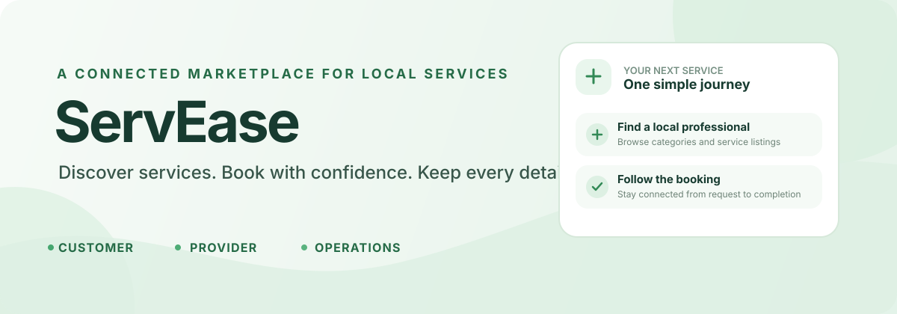
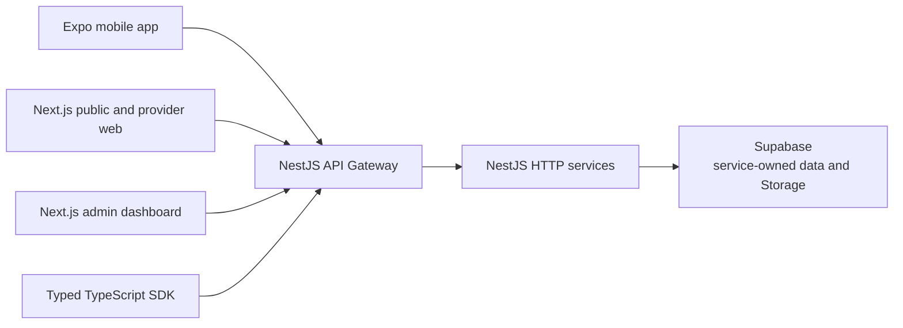

# ServEase

<p align="center">
  
</p>

<p align="center"><strong>A full-stack marketplace for finding, booking, and managing home, personal, and local services.</strong></p>

ServEase brings customer discovery, provider tools, and platform operations into one connected product. This repository contains the mobile app, public and provider web experience, admin dashboard, typed API package, and a service-oriented backend.

## Product areas

- **Customer experience:** Browse service categories and provider listings, request a booking, follow its progress, message a provider, and manage related payments or support.
- **Provider experience:** Maintain a service profile, manage availability, respond to booking requests, update job progress, and review earnings and payouts.
- **Platform operations:** Review provider applications, manage bookings and payments, and handle support, disputes, and moderation from an admin workspace.

These are the product areas represented across the app surfaces and API contracts. Local use of external services depends on your own development credentials and configuration.

## Architecture

The API Gateway is the public backend boundary. It routes requests to independently owned NestJS services over HTTP; services own their data and do not read one another's database tables directly.



### Engineering highlights

- One API Gateway separates public client contracts from internal service routes.
- Backend services communicate over HTTP and own their persistence boundaries.
- Customer and provider workflows share a mobile app, while provider tools are also available on the web.
- The TypeScript SDK exposes approved public API contracts without exposing internal service URLs or database access.
- Public client keys and backend-only credentials are configured separately.

## Technology

| Area | Stack |
| --- | --- |
| Backend | NestJS, TypeScript, HTTP services |
| Mobile | Expo, React Native |
| Web and admin | Next.js, React, TypeScript |
| Auth, data, and uploads | Supabase |
| Shared API client | TypeScript package in `packages/servease-sdk/` |
| Quality tooling | Jest, Vitest, Playwright, Detox, and k6 scripts |

## Repository map

| Path | Purpose |
| --- | --- |
| `backend/` | API Gateway and 11 backend services |
| `mobile/` | Expo customer and provider app |
| `servease-web/` | Public site, account flows, and provider dashboard |
| `admin/` | Admin dashboard for platform operations |
| `packages/servease-sdk/` | Typed client for approved public API routes |
| `docs/` | Architecture, contracts, development guidance, and operational runbooks |

## Run locally

Each app runs as its own workspace. You will need Node.js 20 or newer, npm, and development credentials for the services you want to use. The backend also installs `@implementsprint/sdk` from GitHub Packages, which requires an account with `read:packages` access.

Authenticate to GitHub Packages before installing the backend dependencies:

```sh
gh auth refresh -h github.com -s read:packages
```

Then expose the token to npm for the current terminal session:

```sh
# macOS / Linux
export GITHUB_TOKEN="$(gh auth token)"

# Windows PowerShell
$env:GITHUB_TOKEN = gh auth token
```

Install the workspaces you plan to run:

```sh
npm --prefix backend ci
npm --prefix mobile ci
npm --prefix servease-web ci
npm --prefix admin ci
```

Create each app's local environment file from its example where provided, then fill in your own development values. The [backend](backend/README.md), [mobile](mobile/README.md), and [admin](admin/README.md) guides cover their environment files; the [web guide](servease-web/README.md) lists its required values. Never commit real credentials.

Start the required surfaces in separate terminals:

```sh
npm --prefix backend run dev
npm --prefix mobile start
npm --prefix servease-web run dev
npm --prefix admin run dev
```

For workspace-specific verification commands, see [docs/testing.md](docs/testing.md).

## Project documentation

- [Architecture](docs/architecture.md)
- [Client-to-API map](docs/app-surface-contracts.md)
- [API contracts](docs/api-contracts.md)
- [Testing and verification](docs/testing.md)
- [Complete documentation index](docs/README.md)

## Project status

This is a development portfolio project. No public live demo is linked in this repository; running the full product requires app configuration and external service credentials. Demo data can be seeded into a development environment with `npm --prefix backend run seed:demo`.

## License

No license file is currently included in this repository.
